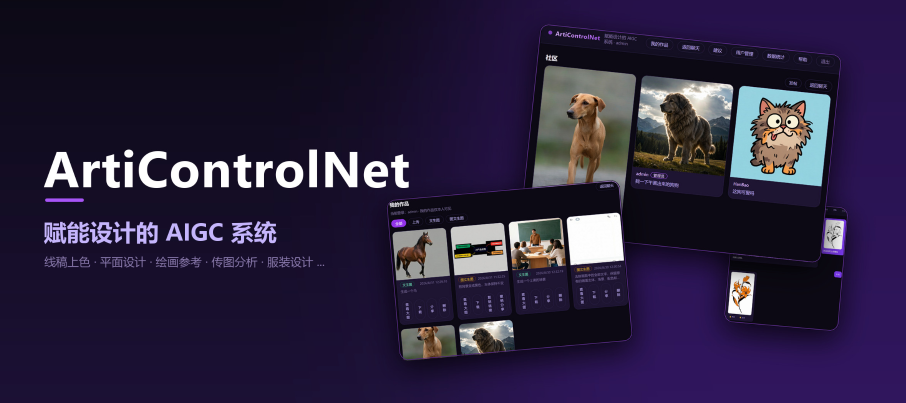

An AI design system for people who can see the image in their head but cannot draw it — describe it in a sentence, or upload a sketch, and get finished artwork back.

ArtiControlNet: Your Design Team, On Call [Website](http://ArtiControlNet.fun/?register=1)
=========================================================================================

**Who it is for.** Design students and working designers — graphic design, illustration, fashion, concept art. And anyone who has never drawn a line in their life but keeps needing visuals anyway: founders, marketers, teachers, a student with a poster due tomorrow. It runs in a browser, on a laptop, a tablet, or a phone.

**What it does.** Say what you want and the image comes back. It works as a conversation, so there is nothing to learn first — describe it the way you would describe it to a colleague, and if you leave something out, it asks you back instead of guessing. Upload a hand-drawn sketch, choose colors and a style, get a finished piece. Or send in a picture you already have and ask about it: critique it, score it, break it down detail by detail. Line-art coloring, graphic design, painting reference, fashion design, image analysis.

**It learns your style.** Everything you upload and generate feeds a private style profile. The more you use it, the more precisely it can describe — and reproduce — the way you work. Your style, written down, on one page.

**Your work stays yours.** Everything you make lives in My Works, visible only to you. When you want an audience, post it to the community. First login walks you through the whole thing.

**Nothing to install.** No graphics card, no setup, no render queue — an ordinary laptop is enough.

**Backed by real work.** It is the applied showcase of a provincial-level undergraduate innovation project, and the source is open on [GitHub](https://github.com/Frosty-Jackal/ArtiControlNet). Suggestions from users get read, answered, and marked resolved.

**Start now.** [Create an account](http://ArtiControlNet.fun/?register=1) and make your first image. Prefer a guided start? Email **frostyj@qq.com** and say you would like to try — GitHub visitors get a fast lane, and your account is set up for you.

------
